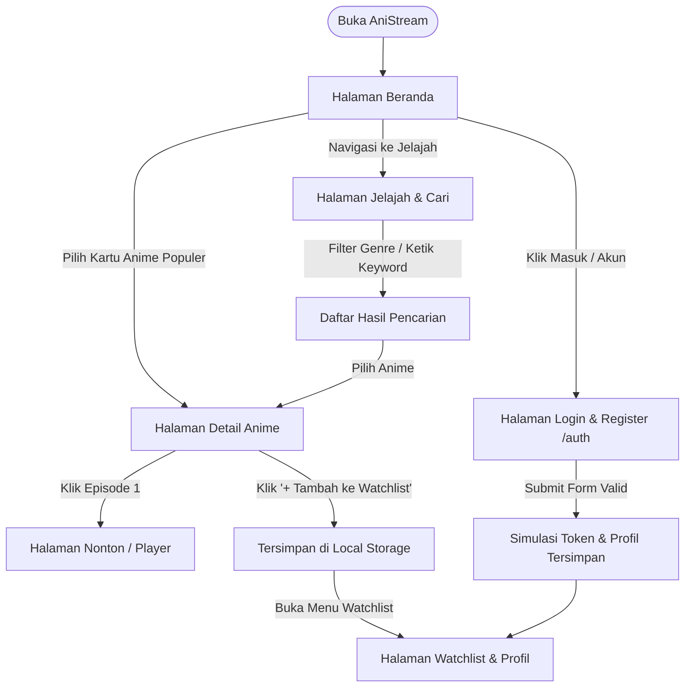

# Alur Pengguna (User Flow) AniStream

Dokumen ini mendefinisikan peta perjalanan pengguna (_customer journey_) saat berinteraksi dengan AniStream, mencakup skenario ideal (_happy path_) untuk fitur MVP dan Post-MVP, serta skenario penanganan kondisi gagal (_error states / edge cases_).

---

## 1. Skenario Sukses Utama (Happy Paths)

### Alur 1: Penemuan & Pemutaran Cepat (Casual Streamer) — [Scope: MVP]

1. **Titik Masuk:** Pengguna membuka Beranda (`/`).
2. **Eksplorasi:** Pengguna disajikan Hero Banner anime unggulan dan carousel anime yang sedang populer/trending musim ini.
3. **Seleksi:** Pengguna mengklik salah satu kartu anime.
4. **Detail:** Pengguna masuk ke Halaman Detail (`/anime/:id`), membaca sinopsis ringkas, melihat genre, skor rating, dan daftar episode.
5. **Aksi Nonton:** Pengguna mengklik "Episode 1" atau tombol "Mulai Nonton".
6. **Pemutaran:** Aplikasi berpindah ke Halaman Player (`/watch/:id/:episode`), video diputar secara otomatis dengan kontrol yang nyaman.

---

### Alur 2: Pencarian & Filter Spesifik (Binge Watcher & New Explorer) — [Scope: MVP]

1. **Titik Masuk:** Pengguna mengakses fitur pencarian lewat input header atau menu Jelajah (`/explore`).
2. **Pencarian / Filter:**
   - Mengetik judul (misal: _"Frieren"_) dengan _debounce query_ (menghindari request berlebih).
   - Memilih filter spesifik (Genre: _Fantasy_, Status: _Completed_, Urutan: _Top Rated_).
3. **Penyajian Data:** Grid kartu anime diperbarui secara dinamis menampilkan judul yang cocok.
4. **Navigasi:** Pengguna mengklik kartu anime untuk masuk ke Halaman Detail.

---

### Alur 3: Manajemen Daftar Tontonan / Watchlist (Local Storage) — [Scope: MVP]

1. **Konteks:** Pengguna sedang berada di Halaman Detail Anime.
2. **Aksi Simpan:** Pengguna menekan tombol interaktif **"+ Tambah ke Watchlist"**.
3. **Feedback UI:** Tombol bertransisi status menjadi tercentang **"✓ Di Watchlist"** disertai notifikasi _toast_ kecil konfirmasi.
4. **Penyimpanan:** Data ID anime, judul, dan poster disimpan ke dalam `localStorage` browser.
5. **Inspeksi:** Pengguna membuka menu **Watchlist / Profil** (`/watchlist`) dan melihat daftar anime tersimpan, siap ditonton kapan saja tanpa perlu akun berbayar.

---

### Alur 4: Simulasi Autentikasi & Personalisasi Akun — [Scope: Post-MVP / Fase 5]

1. **Titik Masuk:** Pengguna mengklik tombol **"Masuk / Daftar"** di navbar header.
2. **Form Interaktif:** Pengguna diarahkan ke Halaman Login & Register (`/auth`). Pengguna dapat beralih antara tab _Login_ dan _Register_.
3. **Validasi Input:** Form memvalidasi input di sisi klien (format email, panjang password, konfirmasi password).
4. **Simulasi State:** Setelah submit valid, sistem mensimulasikan login dengan membuat token dummy dan profil di `localStorage` / central store.
5. **Pembaruan UI:** Pengguna diredirect kembali ke halaman sebelumnya atau ke **Profil & Watchlist** (`/watchlist`). Header memperbarui avatar dan menampilkan nama pengguna.

---

## 2. Skenario Kondisi Gagal & Batas (Edge Cases & Error States)

Frontend yang profesional dirancang tahan banting (_resilient_) terhadap masalah jaringan atau data eksternal. Berikut adalah standar penanganan UI untuk setiap kondisi gagal:

| Kondisi Gagal                                 | Skenario Penyebab                                                            | Apa yang Dilihat Pengguna (UI Handling)                                                                       | Aksi Pemulihan (Recovery Action)                                                   |
| :-------------------------------------------- | :--------------------------------------------------------------------------- | :------------------------------------------------------------------------------------------------------------ | :--------------------------------------------------------------------------------- |
| **Koneksi Putus (Offline)**                   | Jaringan perangkat terputus atau mode pesawat saat aplikasi dibuka/navigasi. | Banner peringatan kuning di bagian atas: _“Koneksi internet terputus. Menampilkan data lokal yang tersedia.”_ | Tombol **"Coba Lagi" (Retry)** untuk merefresh fetch data setelah online kembali.  |
| **Pencarian Kosong (Empty State)**            | Kata kunci pencarian tidak ditemukan di API (0 hasil).                       | Ilustrasi ramah + pesan: _“Tidak ada anime yang cocok dengan kata kunci '[keyword]'.”_                        | Saran pencarian populer dan tombol **"Reset Filter"**.                             |
| **Halaman Tidak Ditemukan (404)**             | Pengguna mengetik URL salah atau ID anime tidak ditemukan di database.       | Halaman error 404 bersih: _“Halaman yang kamu cari tersesat di dimensi lain.”_                                | Tombol navigasi utama: **"Kembali ke Beranda"**.                                   |
| **Gagal Memuat Video (Stream Error)**         | Link stream publik corrupt, offline, atau terblokir CORS.                    | Area player menggelap dengan pesan: _“Video stream tidak dapat dimuat saat ini.”_                             | Tombol **"Segarkan Player"** dan opsi berpindah ke episode berikutnya.             |
| **Batas Kuota API (Rate Limited / HTTP 429)** | Request ke API Jikan melebihi batas (misal: > 3 request per detik).          | Toast banner informatif: _“Server sedang sibuk, memuat ulang dalam beberapa detik...”_                        | Mekanisme _auto-retry with exponential backoff_ transparan di lapisan service.     |
| **Watchlist Masih Kosong**                    | Pengguna membuka halaman `/watchlist` pertama kali.                          | Tampilan ilustrasi watchlist kosong: _“Belum ada anime di daftar tontonanmu.”_                                | Tombol CTA (Call to Action): **"Jelajahi Anime Sekarang"** mengarah ke `/explore`. |
| **Validasi Form Auth Gagal**                  | Format email keliru atau password terlalu pendek pada form `/auth`.          | Pesan error inline merah tepat di bawah input field terkait sebelum tombol submit aktif.                      | Pengguna memperbaiki field spesifik yang ditandai merah.                           |

---

## 3. Matriks Kondisi UI per Halaman (State Matrix)

Setiap halaman berbasis data di AniStream wajib mengimplementasikan 4 kondisi antarmuka standar:

1. **Loading State:** Skeleton loader / spinner halus saat data sedang diambil (mencegah _layout shift_).
2. **Success State:** Data berhasil dimuat dan dirender penuh.
3. **Empty State:** Data berhasil diambil tapi bernilai kosong (array panjang 0).
4. **Error State:** Gagal mengambil data karena kendala jaringan atau server API.
